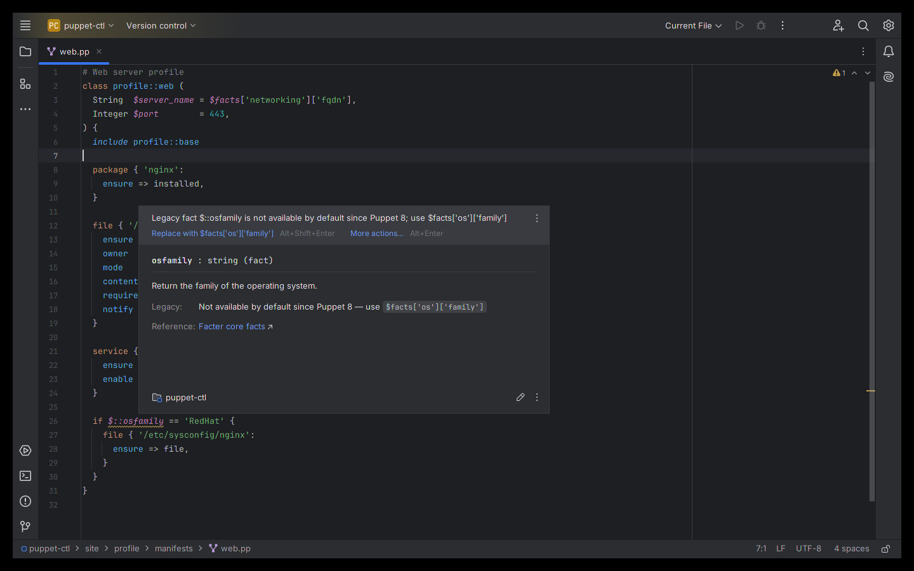
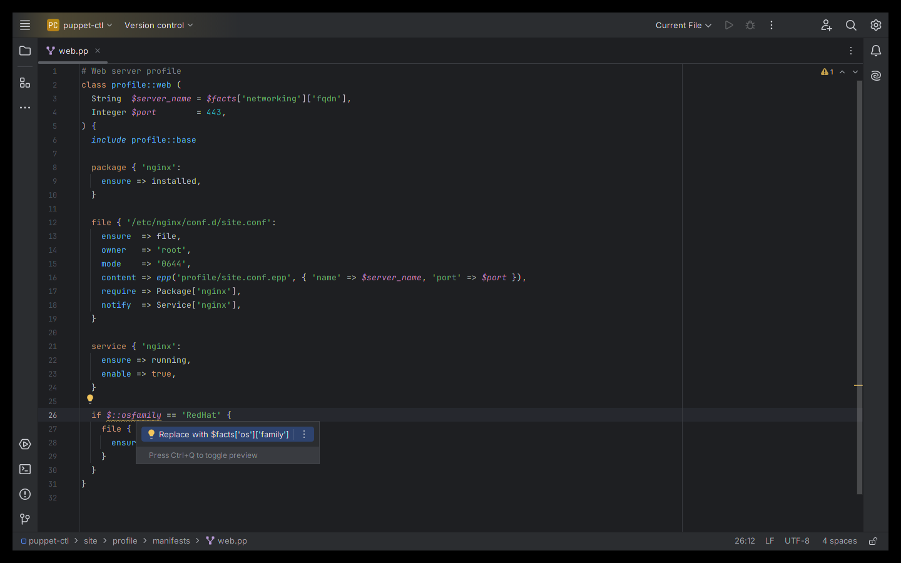

# Puppet Manifest Tools — JetBrains IDE plugin

Language support for **Puppet** and **OpenVox** manifests (`*.pp`), **EPP templates** (`*.epp`), **Puppetfiles** and **Hiera / hiera-eyaml data** in IntelliJ IDEA, PyCharm, GoLand, WebStorm and every
other JetBrains IDE (2024.3 and newer) — no RubyMine required.

Install: *Settings → Plugins → Marketplace → search "Puppet Manifest Tools"*.

## Puppet 8 migration help
Puppet 8 no longer provides legacy (Facter 2 style) facts by default. The plugin flags `$::osfamily`, `$osfamily`,
`$facts['fqdn']` and `"${::hostname}"` and replaces them with the structured fact in one click
(`$facts['os']['family']`, `$facts['networking']['fqdn']`, ...).

## Features
- Syntax highlighting: classes, defined types, resources, attributes, variables, string interpolation, heredocs, regexes
- Completion: resource types, attributes per core type / your defined types / classes, attribute values (`ensure`),
  functions, class names after `include`/`contain`/`require`, variables in scope, structured fact keys in `$facts['...']`
- Go to declaration, find usages and rename for classes, defined types, functions, parameters and variables across the
  project (`include`, `Class['x']`, `class { 'x': }`, `$module::class::var`)
- Inspections: unknown attributes, invalid values (`ensure => runing`), duplicate attributes, missing classes / defined
  types in your own modules, removed syntax (`import`, node inheritance)
- Quick documentation (Ctrl+Q / F1) for resource types, attributes, functions and facts
- EPP templates (`*.epp`): the Puppet code in `<% %>` tags gets the same highlighting, legacy-fact checks and quick
  fixes, completion and navigation as manifests; template parameters (`<%- | String $name | -%>`) resolve and complete;
  unclosed tags are reported
- Hiera data (`data/`, `hieradata/`): keys such as `ntp::servers` link to the class parameter they set by automatic
  parameter lookup (go to declaration, find usages, rename together with the parameter); keys that set no parameter of a
  class in your project (typos, removed parameters, which Puppet silently ignores) are flagged with a "did you mean" fix;
  `class::parameter` keys complete in data files and inside `lookup('...')`; `lookup('key')` jumps to the data files
- hiera-eyaml (`*.eyaml` and encrypted values in Hiera data): long `ENC[PKCS7,...]` ciphertexts fold to `ENC[PKCS7,…]`;
  errors for values Hiera won't decrypt and passes to Puppet as text (missing `]`, non-base64 characters, truncated
  PKCS7 ciphertext, checked without any key) and for decrypted `DEC::PKCS7[...]!` blocks left in a file; a warning when
  `hiera.yaml` reads a file with encrypted values only through `data_hash: yaml_data` instead of `eyaml_lookup_key`;
  a weak warning for plain-text passwords/tokens in `*.eyaml` files
- hiera.yaml (Hiera 5): errors for what makes Puppet reject the config, so that every lookup fails (unknown or
  misspelled keys with a "did you mean" fix, `version: "5"` as a string, duplicate level names, missing or conflicting
  `data_hash`/`lookup_key`, more than one path key, `data_hash: yaml`, `data_hash: eyaml_lookup_key`, reserved
  options, `%{lookup('…')}` in paths, version 3 in a module or environment); legacy facts in `%{...}` interpolations
  (`%{::osfamily}`, `%{fqdn}`), which are empty since Puppet 8, with a one-click fix to `%{facts.os.family}` (also in
  data files); unknown interpolation methods; likely typos in data file paths (`common.yml` vs `common.yaml`); key
  completion and Ctrl+click from a path to its data file
- Reformat Code (Ctrl+Alt+L) in Puppet style: indentation by nesting (2 spaces, or the file's own step), `=>` aligned
  in resource bodies like puppet-lint's arrow_alignment check, trailing whitespace removed; strings, heredocs and
  hand-aligned hashes outside resources are left as they are
- Puppetfile (r10k, Code Manager, g10k, librarian-puppet): highlighting, completion of module options in the file's
  own style (`:git =>` or `git:`), quick documentation, structure view, Ctrl+click from a module to its deployed
  directory or its Forge page, and checks for what makes r10k fail or silently deploy the wrong thing: duplicate module
  names, invalid names and Forge versions, misspelled options (`:brnach`, with a "did you mean" fix), conflicting
  `:tag`/`:branch`, Git modules without a ref (r10k 4+), `git://github.com` URLs (fix to https)
- Structure view, folding, brace matching, commenting

Tested on ~1,000 manifests and 260 templates from 51 public modules (puppetlabs, voxpupuli, theforeman), and the Hiera
support on 1,600 data files with 10,000 keys from public control repositories and modules. Puppetfile support: 16
real Puppetfiles with 618 modules plus the r10k and g10k test suites. hiera-eyaml checks: the encrypted Hiera data of
four public control repositories and the hiera-eyaml test suite (0 false reports), plus deliberately broken copies. hiera.yaml checks: 43 configs, 596 data
files and 1,014 interpolations from public modules and control repositories (only real findings: deprecated Hiera 3
test configs, `%{fqdn}` in a spec fixture), plus 154 broken copies, all caught.

## More Klardaten plugins

- [HAProxy Config](https://github.com/klardaten-dev/haproxy-config) — HAProxy configuration: completion, navigation, 6 inspections, docs from the HAProxy manuals
- [VCL Language Tools](https://github.com/klardaten-dev/vcl-language-tools) — Varnish and Fastly VCL: completion, cross-file navigation, 8 inspections
- [PromQL and Prometheus Rules](https://github.com/klardaten-dev/promql-tools) — PromQL inside .promql and Prometheus rule files, checked like Prometheus itself
- [DNS Zone File Tools](https://github.com/klardaten-dev/dns-zone-tools) — BIND-style zone files: 70+ record types, trailing-dot, CNAME, SPF/DMARC checks

## Source code
The plugin is closed source (free to use under the EULA); this repository hosts its documentation, license and issue tracker. The source code is not public.

## Support
Please open an [issue](../../issues) with your IDE version and a minimal manifest snippet (remove secrets first).

## Privacy
The plugin works fully offline and collects no data. See [PRIVACY.md](PRIVACY.md).

## License
Free to use under the [End User License Agreement](EULA.md). Type, function and fact data derived from the Puppet and
Facter sources (Apache License 2.0); notice shipped in the plugin as `META-INF/NOTICE.txt`.

---
Independent project, not affiliated with or endorsed by Puppet by Perforce or the OpenVox project. Puppet is a
trademark of its respective owner. JetBrains and IntelliJ are trademarks of JetBrains s.r.o.
