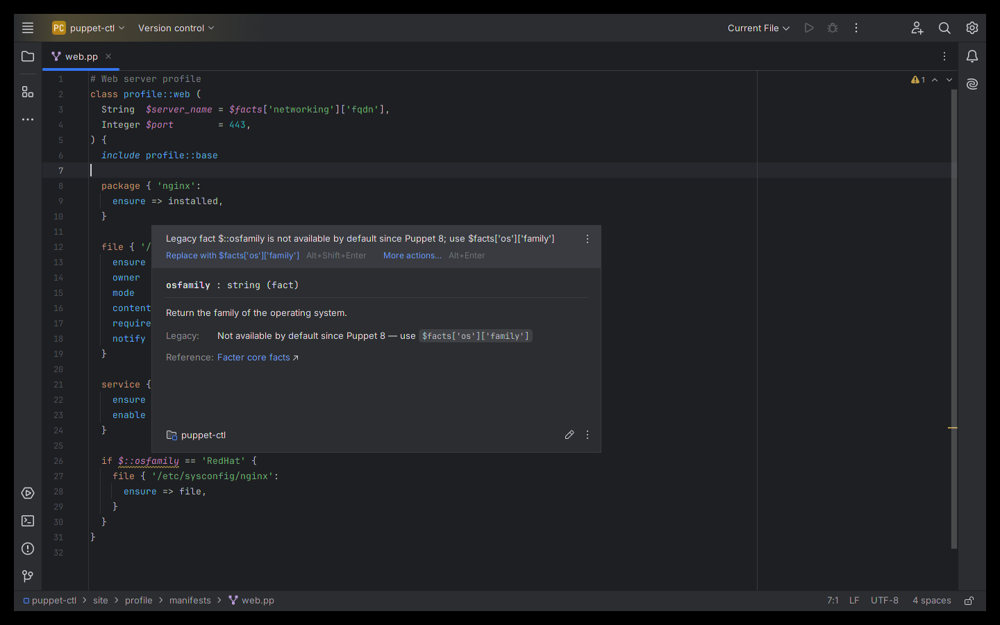
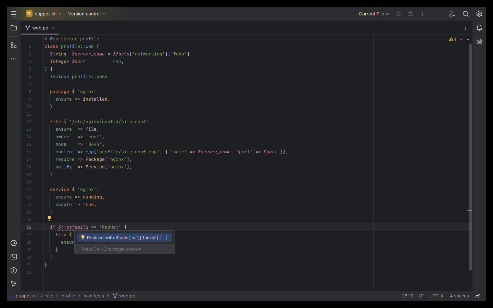

# Puppet Manifest Tools — JetBrains IDE plugin

Language support for **Puppet** and **OpenVox** manifests (`*.pp`) in IntelliJ IDEA, PyCharm, GoLand, WebStorm and every
other JetBrains IDE (2024.3 and newer) — no RubyMine required.

Install: *Settings → Plugins → Marketplace → search "Puppet Manifest Tools"*.

## Puppet 8 migration help
Puppet 8 no longer provides legacy (Facter 2 style) facts by default. The plugin flags `$::osfamily`, `$osfamily`,
`$facts['fqdn']` and `"${::hostname}"` and replaces them with the structured fact in one click
(`$facts['os']['family']`, `$facts['networking']['fqdn']`, ...).

## Features
- Syntax highlighting: classes, defined types, resources, attributes, variables, string interpolation, heredocs, regexes
- Completion: resource types, attributes per core type / your defined types / classes, attribute values (`ensure`),
  functions, class names after `include`/`contain`/`require`, variables in scope, structured fact keys in `$facts['...']`
- Go to declaration, find usages and rename for classes, defined types, functions, parameters and variables across the
  project (`include`, `Class['x']`, `class { 'x': }`, `$module::class::var`)
- Inspections: unknown attributes, invalid values (`ensure => runing`), duplicate attributes, missing classes / defined
  types in your own modules, removed syntax (`import`, node inheritance)
- Quick documentation (Ctrl+Q / F1) for resource types, attributes, functions and facts
- Structure view, folding, brace matching, commenting

Parses all 234 manifests of puppetlabs-apache, -stdlib, -mysql, -postgresql, -concat, -firewall, -ntp and
voxpupuli/puppet-nginx without errors.

## Source code
The plugin is closed source (free to use under the EULA); this repository hosts its documentation, license and issue tracker. The source code is not public.

## Support
Please open an [issue](../../issues) with your IDE version and a minimal manifest snippet (remove secrets first).

## Privacy
The plugin works fully offline and collects no data. See [PRIVACY.md](PRIVACY.md).

## License
Free to use under the [End User License Agreement](EULA.md). Type, function and fact data derived from the Puppet and
Facter sources (Apache License 2.0); notice shipped in the plugin as `META-INF/NOTICE.txt`.

---
Independent project, not affiliated with or endorsed by Puppet by Perforce or the OpenVox project. Puppet is a
trademark of its respective owner. JetBrains and IntelliJ are trademarks of JetBrains s.r.o.
